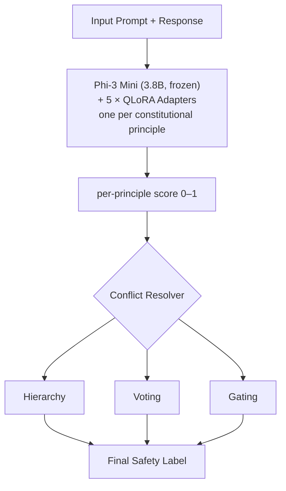

# HAVEN: Constitutional Safety Framework & Evaluator Audit

## What is HAVEN?

Modern LLM safety classifiers treat safety as a binary choice between safe and unsafe. HAVEN argues this is insufficient. A response can be *harmless but dishonest*. It can be *helpful but disrespectful*. Safety is **multi-dimensional**.

HAVEN decomposes safety evaluation into **five constitutional principles**, trains a dedicated QLoRA-adapted classifier for each over a frozen Phi-3 Mini (3.8B) base, and implements three conflict resolution arbitration mechanisms:

| Principle | What it checks |
|---|---|
| **Harmlessness** | Does the response avoid harm, danger, or illegal content? |
| **Helpfulness** | Does the response genuinely address the user's need? |
| **Honesty** | Is the response factually accurate and non-deceptive? |
| **Respectfulness** | Is the tone respectful and free from bias or stereotypes? |
| **Truthfulness** | Is the response grounded in verifiable truth? |

---

## Architecture



### Conflict Resolution Strategies

- **Hierarchy**: Principles have a fixed priority order. Harmlessness always wins.
- **Voting**: Majority vote across all 5 principles determines the final label.
- **Gating**: A learned gate dynamically weights each principle based on context.

---

## Results & Systems Audit

Evaluated on **HAVEN-Bench** (1,398 held-out test examples, safe prior $\pi \approx 0.5229$) drawn from PKU-SafeRLHF, BBQ, HaluEval, and TruthfulQA. All metrics directly reflect real evaluation outputs saved in `results/`.

| System | TP / FP / TN / FN | Accuracy | Safe Recall | Unsafe Recall | Unsafe F1 | Macro-F1 |
|---|---|---|---|---|---|---|
| **Always-Safe (constant baseline)** | 0 / 0 / 731 / 667 | 52.3% | 100.0% | 0.0% | 0.0% | 34.3% |
| **Rule-Based (baseline)** | 217 / 48 / 683 / 450 | 64.4% | 93.4% | 32.5% | 46.6% | 59.9% |
| **RoBERTa (baseline)** | 572 / 99 / 632 / 95 | 86.1% | 86.5% | 85.8% | 85.5% | 86.1% |
| **HAVEN (pipeline audit run)** | 0 / 0 / 731 / 667 | 52.3% | 100.0% | 0.0% | 0.0% | 34.3% |

### Understanding the Results: Audit & Metric Vulnerabilities

During empirical benchmarking, HAVEN served as a real-world case study exposing how ML evaluation pipelines can fail silently. When adapter checkpoint loading defaulted to a constant fallback score of 0.5, aggregate metrics yielded 52.3% accuracy and 100% safe-class recall (identical to an Always-Safe constant predictor). 

This demonstrates that aggregate metrics (Accuracy, Safe Recall, ECE) can mask a degenerate predictor even on a near-balanced test set, and the masking worsens as class imbalance grows:
- **Closed-Form ECE Masking**: A constant 0.5 score achieves an ECE of $|\pi - c| = |0.5229 - 0.5| = 0.023$, creating a false illusion of calibration.
- **Directional Discordance**: McNemar's test yielded $p < 10^{-20}$ ($p = 5.7 \times 10^{-25}$ vs. Rule-Based; $p = 3.5 \times 10^{-74}$ vs. RoBERTa), which without directional reporting obscures that statistical significance strictly favors the comparators.

To prevent silent failures, HAVEN formalizes a **6-Layer Audit Protocol** (Execution, Prediction, Benchmark, Metric, Statistical, and Semantic integrity) with tiered runtime invariants (Hard Halt vs. Soft Warning).

### Dataset Audit Finding: Binary Harmonization Conflation

Applying the Semantic audit layer to our benchmark (HAVEN-Bench), we found that **27.3% (182 of 667) of "unsafe" test labels came from the binary harmonization rule** rather than source safety violations. PKU-SafeRLHF annotates safety and preference separately, but our harmonizer gave every dispreferred response a Helpfulness label of 0, and any 0 makes an example "unsafe". As a result, benign responses were labeled "unsafe" simply because they lost a pairwise preference comparison.

---

## Dataset: HAVEN-Bench

HAVEN-Bench is a harmonized multi-principle safety benchmark comprising **9,317 prompt-response pairs** (6,000 PKU-SafeRLHF responses from 3,000 pairs, 2,000 HaluEval, 817 TruthfulQA, 500 BBQ), partitioned via random sampling (seed 42) into:
- **Training Split (70%)**: 6,521 examples
- **Validation Split (15%)**: 1,398 examples
- **Held-Out Test Split (15%)**: 1,398 examples (731 safe / 667 unsafe, $\pi \approx 0.5229$)

### Test Split Composition (1,398 Examples)

| Source Dataset | Principle(s) | Total ($n$) | Safe ($y=1$) | Unsafe ($y=0$) |
|---|---|---|---|---|
| **PKU-SafeRLHF** | Harmlessness, Helpfulness | 892 | 225 | 667 |
| **HaluEval** | Honesty | 287 | 287 | 0 |
| **BBQ** | Respectfulness | 99 | 99 | 0 |
| **TruthfulQA** | Truthfulness | 120 | 120 | 0 |
| **Total Test Split** | **Multi-Principle Safety** | **1,398** | **731** | **667** |

---

## Repository Structure

```
haven/
├── checkpoints/                # Trained QLoRA adapters (gitignored)
├── data/                       # HAVEN-Bench CSV splits
│   └── raw/
├── experiments/
│   └── run_comparison.py       # Full evaluation pipeline
├── notebooks/                  # Dataset exploration and figures notebooks
├── results/                    # Real evaluation outputs (metrics, predictions, figures)
├── results_synthetic/          # Baseline outputs on synthetic data
├── src/
│   ├── baselines/
│   │   ├── monolithic.py       # Single-classifier baseline
│   │   ├── roberta_baseline.py # RoBERTa fine-tuning baseline
│   │   ├── rule_based.py       # Rule-based keyword classifier
│   │   └── zeroshot_llm.py     # Zero-shot LLM baseline
│   ├── data/
│   │   ├── dataset.py          # Dataset class & data loaders
│   │   └── harmonizer.py       # Dataset loading & harmonization
│   ├── resolvers/
│   │   ├── gating.py           # Context-conditioned gating
│   │   ├── hierarchy.py        # Principle priority resolver
│   │   └── voting.py           # Majority vote resolver
│   ├── analysis.py             # Result analysis & case studies
│   ├── calibration.py          # Temperature scaling & ECE
│   ├── conflict_detector.py    # Detects cross-principle conflicts
│   ├── constitution.py         # Constitutional principle definitions
│   ├── evaluator.py            # HAVEN inference pipeline
│   ├── metrics.py              # Accuracy, F1, ECE, McNemar
│   └── trainer.py              # QLoRA fine-tuning per principle
├── .gitignore
├── README.md
├── TRAINING.md                 # Kaggle training guide
└── requirements.txt
```

---

## Quickstart

HAVEN offers three ways to explore the project, depending on your needs.

### Option A: View Pre-computed Results (No coding required)
All evaluation results (metrics and figures) are already saved in the repository.
```bash
# Step 1: Clone the repository
git clone https://github.com/sakshi-kadian/haven.git
cd haven
# Explore the results/ folder
```

### Option B: Run Evaluation (Requires Checkpoints & Data)
If you have the `checkpoints/` and `data/` folders, you can run the inference pipeline directly:
```bash
# Step 1: Clone the repository
git clone https://github.com/sakshi-kadian/haven.git
cd haven

# Step 2: Install dependencies
pip install -r requirements.txt

# Step 3: Run the evaluation script (ensure data/ is populated per TRAINING.md)
python experiments/run_comparison.py --data_path data/haven_bench_test.csv
```

### Option C: Full Reproduction from Scratch
To download the data, train the QLoRA adapters, and reproduce everything from scratch on a free Kaggle T4 GPU, follow the complete guide in **[TRAINING.md](TRAINING.md)**.

---

## Research Questions & Findings

**1. Does constitutional decomposition improve over monolithic classifiers?**
> **Not tested.** The evaluated run bypassed all five trained adapters, so this repository makes no claim about decomposition versus monolithic classification. For reference, the RoBERTa baseline reaches 86.1% accuracy on the same test split.

**2. How do conflict resolution mechanisms arbitrate principle tensions?**
> **Not measured empirically.** Hierarchy (fixed priority order), Voting, and learned Gating are implemented in `src/resolvers/`, but the evaluated run fed them constant 0.5 scores, so their relative performance was not measured.

**3. Are standard aggregate metrics reliable for modular LLM evaluation pipelines?**
> **No. Aggregate metrics fail to expose degenerate predictors under class imbalance.** In our case study, an execution fallback resulting in a constant 0.5 predictor achieved 52.3% aggregate accuracy and 100% safe-class recall. Without class-decoupled metrics (unsafe recall, macro-F1) and prediction variance checks, standard metrics mask degenerate predictors.

---

## Limitations

- **Benchmark coverage:** All unsafe test examples come from PKU-SafeRLHF; the HaluEval, BBQ, and TruthfulQA subsets contain only safe examples, and HaluEval text fields were empty after ingestion. Negative-class detection cannot be measured for three of the five principles.

- **Dataset-specific fine-tuning:** HAVEN is fine-tuned on four specific datasets (PKU-SafeRLHF, BBQ, HaluEval, TruthfulQA). Generalization to novel safety scenarios or unseen domains is not evaluated.

- **Binary classification oversimplifies safety:** Safety exists on a spectrum. Our five-principle decomposition adds nuance, but thresholding at 0.5 still loses gradations.

- **Five principles are not exhaustive:** The framework addresses Harmlessness, Honesty, Helpfulness, Respectfulness, and Truthfulness. Other important dimensions (privacy, consent, copyright) are not covered.

- **Single held-out test set:** Results are reported on one fixed test split. Cross-validation or evaluation on external datasets would further strengthen generalization claims.

---

*Developed as an independent research project.*
